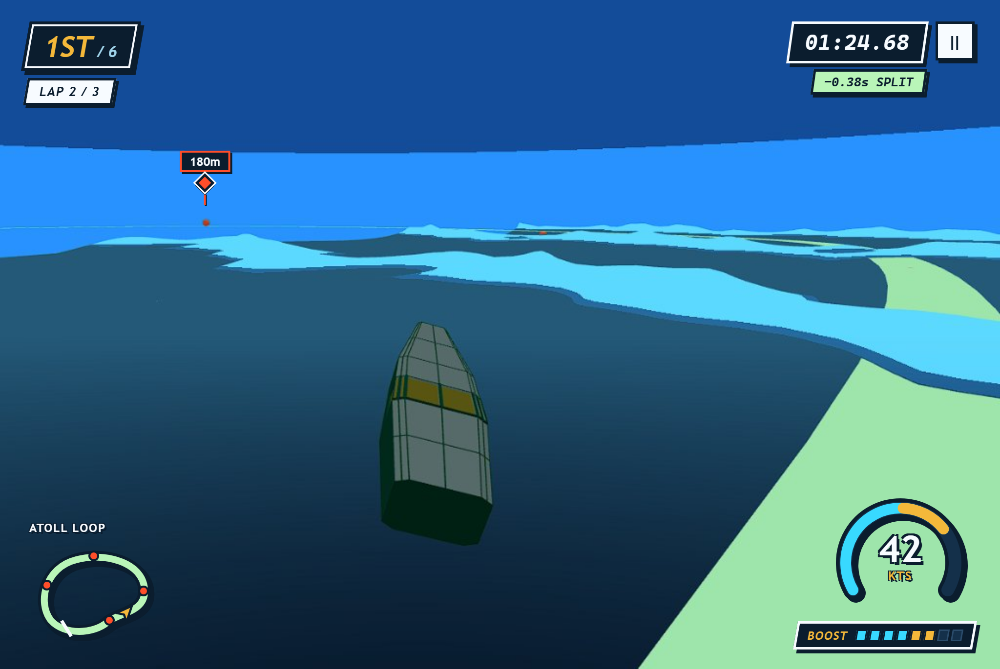

# Game HUD & UI Advisor MCP

A read-only stdio MCP server for grounded, provenance-aware **in-game UI & HUD design advice** — built for AI coding agents creating browser/Three.js games and cross-engine HUDs.

Modeled on the safety and provenance architecture of `html-design-advisor-mcp`, this server pairs an original game-UI taxonomy and pattern catalog with read-only discovery of local game/Three.js repositories and inert static auditing of local HUD files.

This project is released under the [MIT License](LICENSE). Original code, documentation, and pattern blueprints are MIT-licensed; third-party assets and external references retain their own terms.

## Showcase: `cel-ocean-racer` HUD Concept

Example HUD concept generated from `game-hud-ui-advisor` recommendations (`racing-arcade-hud` + `threejs-dom-overlay-hud` + `cel-shaded-stylized`) for a cel-shaded Three.js ocean boat racer, rendered as a real DOM/SVG overlay and verified with `audit_local_game_ui` (**0 findings**):



**Sample brief passed to `recommend_game_ui` & `get_game_ui_guidance`:**
- `screen_or_hud`: `"racing HUD speedometer lap timer boost meter buoy waypoints minimap"`
- `genre`: `"racing-flight"`
- `visual_direction`: `"threejs cel-shaded stylized vibrant ocean crisp ink outlines"`
- **Result:** Ranks `racing-arcade-hud` #1 and `threejs-dom-overlay-hud` #2, excludes `action-combat-hud` (non-combat racing mismatch), activates `cel-shaded-stylized` + `threejs-webgl-hud` guidance, and passes `audit_local_game_ui` with `pointer-events: none` canvas passthrough, `user-select: none`, `tabular-nums`, `:focus-visible`, `prefers-reduced-motion`, and zero `backdrop-filter: blur(...)` overhead.

## Game UI Database Policy (No Scraping)

[Game UI Database](https://www.gameuidatabase.com/) has no public API, showcases copyrighted game studio UIs, and explicitly prohibits automated AI scraping, harvesting, or asset generation. Accordingly, this MCP **never fetches, scrapes, or redistributes** Game UI Database pages or screenshots. Instead, it cites `gameuidatabase.com` strictly as a **human look-don't-copy visual-study pointer** with suggested manual search keywords alongside open-licensed resources (Kenney CC0, Game-icons.net CC BY 3.0, Three.js MIT).

## Tools & Resources

- **`search_game_ui_patterns(query, category="", limit=8)`**: Search original HUD/menu blueprints and optional validated local catalog entries.
- **`recommend_game_ui(...)`**: Map screen/HUD job, genre, input modality (`kbm`, `gamepad`, `touch`, `vr`), visual direction, diegetic preference, constraints, and accessibility needs to ranked patterns, safe-zone layouts, explicit conflict exclusions, and human study keywords.
- **`list_game_ui_references()`**: Non-recursive, read-only inventory of sibling game and Three.js projects with license pointers. Copy `references.local.json.example` → `references.local.json` (gitignored) to include private local repositories on your machine.
- **`get_game_ui_guidance(brief="")`**: Core game-UI principles plus opt-in direction packs (`threejs-webgl-hud`, `cel-shaded-stylized`, `minimal-diegetic`, `tactical-4x-dense`, `vr-spatial-hud`, `unity-godot-engine`, `retro-pixel`).
- **`audit_local_game_ui(path)`**: Root-jailed, inert (`<= 1 MB`) static heuristic check for `.html`, `.htm`, `.css`, `.js`, `.mjs`, `.jsx`, and `.tsx` HUD files (checks `pointer-events` canvas passthrough, `user-select: none`, tiny `<12px` HUD text, `:focus-visible`, `prefers-reduced-motion`, excessive `backdrop-filter: blur(...)`, etc.).
- **Resources**: `game-ui-advisor://sources`, `game-ui-advisor://taxonomy`, `game-ui-advisor://local-assets`.

## Development

Python 3.11+ required.

**Windows (PowerShell):**
```powershell
uv venv .venv
uv pip install --python .\.venv\Scripts\python.exe -e ".[test]"
.\.venv\Scripts\python.exe -m pytest -q
.\.venv\Scripts\python.exe -m game_hud_ui_advisor
```

**macOS / Linux:**
```bash
python3 -m venv .venv
.venv/bin/python -m pip install -e ".[test]"
.venv/bin/python -m pytest -q
.venv/bin/python -m game_hud_ui_advisor
```

## MCP Client Configuration

Point your MCP client at the virtual environment's Python interpreter (using your local repository path):

```json
{
  "mcpServers": {
    "game-hud-ui-advisor": {
      "command": "<path-to-game-hud-ui-mcp>/.venv/Scripts/python.exe",
      "args": ["-m", "game_hud_ui_advisor"]
    }
  }
}
```

*(On macOS/Linux, use `<path-to-game-hud-ui-mcp>/.venv/bin/python`.)*
